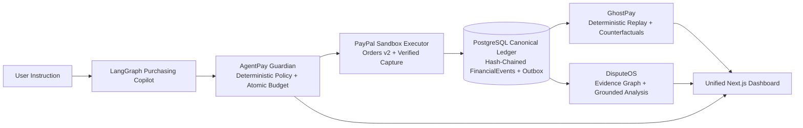

# AgentPay Nexus — The Financial Digital Twin for Agentic Commerce

AgentPay Nexus unifies **AgentPay Guardian**, **GhostPay**, and **DisputeOS** on one shared identity model, one canonical transaction model, one hash-chained event ledger, and one evidence provenance store.

## Current Repository Status

| Component | Path | Branch | Status |
| :--- | :--- | :--- | :--- |
| Canonical Contracts & Fixtures | `packages/contracts/` | `main` | Implemented & tested |
| Security & Hash-Chain Primitives | `packages/security/` | `main` | Implemented & tested |
| PostgreSQL ORM, Alembic & Atomic Ledger | `packages/database/` | `main` | Implemented & tested |
| Isolated PayPal Sandbox Client | `packages/paypal/` | `main` | Implemented & tested |
| **DisputeOS** | `modules/disputeos/` | `feature/disputeos` (integrated) | Implemented & tested |
| **AgentPay Guardian** | `modules/agentpay-guardian/` | `feature/guardian` (integrated) | Implemented & tested |
| **GhostPay** | `modules/ghostpay/` | `feature/ghostpay` (integrated) | Implemented & tested |
| Unified FastAPI & Worker | `services/api/`, `services/worker/` | `integration/nexus` | Scaffolded for team handoff |
| Unified Next.js Dashboard | `apps/web/` | `integration/nexus` | Scaffolded for team handoff |

## Architecture



## Quick Start

```bash
# 1. Copy environment variables
cp .env.example .env

# 2. Install Python 3.12 workspace dependencies
uv sync --python 3.12

# 3. Run all verified tests
make test

# 4. Start PostgreSQL and run Alembic migrations
make up
make migrate
```

## Team Workflow & Branching

- `main`: Frozen shared contracts (`packages/contracts/`), shared infrastructure (`packages/{security,database,paypal}`), CI, and DisputeOS.
- `feature/disputeos`: DisputeOS module (`modules/disputeos/`).
- `feature/guardian`: Teammate branch for `modules/agentpay-guardian/`.
- `feature/ghostpay`: Teammate branch for `modules/ghostpay/`.
- `integration/nexus`: Integration branch for `services/api/`, `services/worker/`, `apps/web/`, and E2E verification.

See [docs/TEAM_HANDOFF.md](docs/TEAM_HANDOFF.md) and [research/repositories/REUSE_MATRIX.md](research/repositories/REUSE_MATRIX.md) for detailed module contracts and open-source licensing notes.


## Standalone GhostPay service

GhostPay includes a tenant-authenticated, read-only forensic console and API with
Docker deployment support. See [GhostPay deployment](modules/ghostpay/DEPLOYMENT.md)
and [verification status](modules/ghostpay/STATUS.md). Public server deployment
and live Sandbox acceptance are separate from local container verification.
