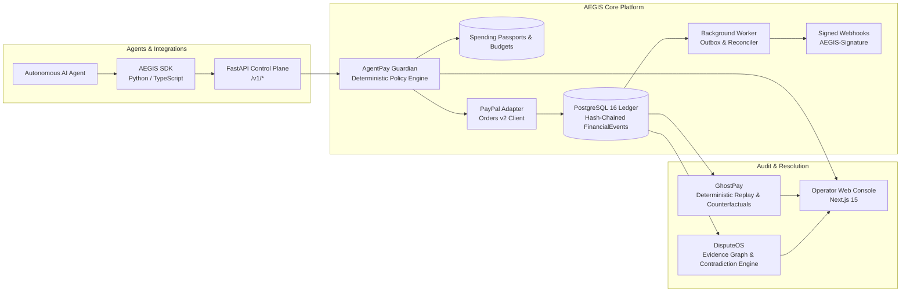

# AEGIS — The Financial Black Box for AI Agents
*(Agentic Enforcement, Governance and Investigation System / AgentPay Nexus)*

AEGIS unifies **AgentPay Guardian**, **GhostPay**, and **DisputeOS** on a shared multi-tenant identity model, canonical transaction state machine, cryptographic hash-chained event ledger, and evidence provenance store.

---

## 1. Verified Repository Status

| Component | Path | Implementation & Verification Status |
| :--- | :--- | :--- |
| **Canonical Contracts & Enums** | `packages/contracts/` | Implemented & verified (Pydantic v2, state machine transitions) |
| **Security, RBAC & Hashes** | `packages/security/` | Implemented & verified (6 RBAC roles, PBKDF2-SHA256, HS256 JWT, HMAC-SHA256) |
| **PostgreSQL ORM & Migrations** | `packages/database/` | Implemented & verified (Alembic 2 revisions, PostgreSQL 16 row locking concurrency) |
| **PayPal Sandbox Adapter** | `packages/paypal/` | Implemented & verified (Deterministic mock transport verified; live PayPal sandbox API unverified) |
| **AgentPay Guardian** | `modules/agentpay-guardian/` | Implemented & verified (Deterministic policy engine, Spending Passports, budget coordinator) |
| **GhostPay** | `modules/ghostpay/` | Implemented & verified (Deterministic replay engine, counterfactual policy simulator, immutable snapshots) |
| **DisputeOS** | `modules/disputeos/` | Implemented & verified (Evidence graphs, contradiction detection, human-in-the-loop review) |
| **Unified FastAPI Service** | `services/api/` | Implemented & verified (69 REST endpoints, rate limiting, correlation tracking) |
| **Durable Background Worker** | `services/worker/` | Implemented & verified (Transactional outbox processor, signed webhook dispatcher, PayPal reconciliation) |
| **Operator Web Console** | `apps/web/` | Implemented & verified (Next.js 15 App Router, TypeScript, Tailwind CSS, 14 built routes) |
| **Python SDK (`aegis-sdk`)** | `packages/sdk-python/` | Implemented & verified (Synchronous typed client, `AgentAuthorizationTool`, webhook verification) |
| **TypeScript SDK (`@aegis-platform/sdk`)** | `packages/sdk-typescript/` | Implemented & verified (Zero-dependency Node.js client, typed methods, timing-safe webhook verification) |

> [!NOTE]
> **Deployment & Platform Reality**: AEGIS is engineered and verified for Linux container environments (Docker, PostgreSQL 16) and standard web browsers. There are **no mobile or Android staging applications** in this repository; any external Android staging claims are strictly unverified and omitted from documented system capabilities.

---

## 2. System Architecture



---

## 3. Quick Start

### Prerequisites
- Python 3.12+ and `uv`
- Node.js 20+ and `npm`
- Docker & Docker Compose (for PostgreSQL 16)

```bash
# 1. Clone & copy environment configuration
cp .env.example .env

# 2. Install Python workspace dependencies
uv sync --python 3.12

# 3. Start local PostgreSQL 16 container and run migrations
make up
make migrate

# 4. Run test suites across the workspace
make test

# 5. Build and test the Web Console
cd apps/web && npm install && npm run build
```

---

## 4. Documentation & Resources

- **Developer & Integration**:
  - [SDK Integration Guide](docs/sdk/INTEGRATION_GUIDE.md)
  - [Architecture Threat Model & Trust Assumptions](docs/architecture/THREAT_MODEL_AND_TRUST_ASSUMPTIONS.md)
  - [Platform Build & Verification Report](docs/AEGIS_PLATFORM_BUILD_REPORT.md)
  - [Stabilization & Branch Reconciliation Report](docs/AEGIS_STABILIZATION_REPORT.md)
- **Legal & Compliance**:
  - [Terms of Service](docs/legal/TERMS_OF_SERVICE.md)
  - [Privacy Policy](docs/legal/PRIVACY_POLICY.md)
  - [Data Processing Addendum (DPA)](docs/legal/DATA_PROCESSING_ADDENDUM.md)
  - [Non-Custodial Architecture & Perimeter](docs/compliance/NON_CUSTODIAL_PERIMETER.md)
- **Operations & Runbooks**:
  - [Incident Response Runbook](docs/runbooks/INCIDENT_RESPONSE.md)
  - [PostgreSQL PITR Recovery Runbook](docs/runbooks/PG_PITR_RECOVERY.md)
  - [Webhook Outbox & DLQ Management](docs/runbooks/WEBHOOK_DLQ.md)
  - [Public Service Status & SLA](docs/status/STATUS_PAGE.md)
