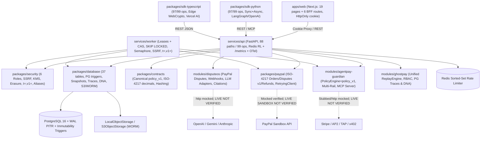

# 01 — Repository & Architecture Forensic Audit

**Audited State:** `integration/nexus` *(post-M1 `d9ab7b8` + M3 `4b5d52f` + M2 `3bbaeb6` merge + post-merge integration fixes)*  
**Workspace Root:** `/home/bigboyaks/Projects/agentpay-nexus`  
**Remote:** `origin -> https://github.com/abhinav29102005/agentpay-nexus.git`  
**Total Baseline Delta (`1be376e` -> Integrated `HEAD` + fixes):** **`245+` files changed, `+47,751 / -4,209` lines** (0 merge conflicts across all 3 machine branches).

---

## 1. Git, Branch & Monorepo Hygiene (`2026-11-12` Integrated)

| Ref / Branch | Observed State (`VERIFIED`) | Sync Status & Notes |
| :--- | :--- | :--- |
| `work/m1-platform-security-infra` | Local + remote `d9ab7b8` | **PUSHED & MERGED** — Platform security, DB triggers/tables, worker leases, billing/erasure, Docker/CI/VPS infra (`59` files). |
| `work/m2-financial-forensics-ai` | Local + remote `3bbaeb6` | **PUSHED & MERGED** — Financial core, contracts `policy_v1`, ISO-4217 PayPal/disputes/refunds, Stripe/AP2/TAP/x402, GhostPay consolidation, LLM adapters, MCP server (`85` files). |
| `work/m3-web-sdks-qa` | Local + remote `4b5d52f` | **PUSHED & MERGED** — Next.js `HttpOnly` BFF + UI contract/commercial views, Python & TS SDKs + agent middlewares, docs, root `tests/` QA harness (`82` files). |
| `integration/nexus` | Unified integrated branch | Merges all 3 machine branches + post-merge integration fixes (`platform_repo.py` SQLite CAS outbox claim, `98.0%` SDK parity, `vite` devDep, `0` Ruff errors, `"tests"` in `pyproject.toml` `testpaths`). |
| `main` | `0108f84` (`origin/main`) | Left untouched per release rule. |
| `packages/ui/` | Removed (`rmdir`) | Empty leftover directory cleaned up cleanly. |

---

## 2. Monorepo Component Inventory (Post-Integration Verified State)

- **Shared Packages (`packages/`):**
  - `packages/contracts/` (`nexus-contracts`): M2 added `contracts.policy_v1` (canonical deterministic policy evaluator), ISO-4217 currency utilities (`decimal_utils` / `minor_to_decimal_str`), `providers.py`, `hashing.py` (`compute_quote_hash`), expanded Pydantic v2 models/enums (`DisputeStatus` transitions, `QuoteSnapshot` validation), and updated `schemas/contracts.schema.json`.
  - `packages/security/` (`nexus-security`): M1 hardened `settings.py` (env aliases + posture validation), `auth.py` (6 canonical `Role`s, `OWNER` guard, TOTP MFA, OIDC), `tenant.py` (sanitized 403), `hashing.py` (`AEGIS-Signature: t=,v1=`), `ssrf.py`, `kms.py`, `erasure.py`.
  - `packages/database/` (`nexus-database`): M1+post-merge — `37` SQLAlchemy 2.0 ORM tables (`0001`–`0003` migrations), PG `financial_events` immutability trigger (`BEFORE UPDATE OR DELETE`), `FOR UPDATE` sequence lock, snapshot/trace/DNA/LLM log tables, `S3ObjectStorage` WORM + 10MB streaming writes, and dual-dialect PG `SKIP LOCKED` + SQLite CAS `claim_due_outbox_events`.
  - `packages/paypal/` (`nexus-paypal`): M2 upgraded `client.py` (`767` lines) — ISO-4217 currency exponents (`JPY`/`BHD`/`KWD`), `RetryingHTTPClient`, pre-capture `CAPTURE_PENDING` state guard, refunds, `PayPalDisputeAdapter` integration (`provide-evidence`, `accept-claim`, `list_disputes`), strict `PayPalTimeoutError`/`PayPalAPIError` exceptions, and `test_live_sandbox_optional.py`.
  - `packages/sdk-python/` (`aegis-sdk`): M3 + post-merge — `client.py` (`2,352` lines), `AsyncAegisClient`, `pagination.py`, `webhook.py` (`t=,v1=`), `integrations/{langchain,openai_agents}.py`, `py.typed`, covering **`97 / 99` (`98.0%`) OpenAPI ops**.
  - `packages/sdk-typescript/` (`@aegis-platform/sdk`): M3 + post-merge — `client.ts` (`967` lines), `crypto.ts` (Node + WebCrypto `t=,v1=`), `errors.ts`, `types.ts`, `integrations/vercel-ai.ts`, `vitest` (`35/35`) + `node --test` (`3/3`) + `tsc` build, covering **`97 / 99` (`98.0%`) OpenAPI ops**.
- **Domain Modules (`modules/` — All Upgraded & Integrated via M2):**
  - `modules/agentpay-guardian/`: Fixed `approved=False` (`service.py`), `approval.payment_intent_id` binding + unconditional quote hash/expiry (`approvals/service.py`), shared `policy_v1` integration (`policies/engine.py`), `PaymentCoordinator` retries/timeouts/reconcile/refunds, `guardian/providers/{stripe,ap2,tap,x402,deflection}.py`, `PurchasingCopilot`, and JSON-RPC 2.0 `mcp_server.py` (`598` lines).
  - `modules/ghostpay/`: Retired legacy `timemachine/replay.py` & `forensics/{anomalies,provenance,timeline}.py` split-brain; wired canonical `policy_v1` parity, full `ProvenanceVerifier` digest cascade, `anomalies/detector.py`, Agent DNA profiling, and internal router RBAC (`GHOSTPAY_READ`/`GHOSTPAY_SIMULATE`) backed by PG snapshot/trace/DNA repos (`adapters.py`).
  - `modules/disputeos/`: Real `PayPalDisputeAdapter` (`provide-evidence`, `accept-claim`), `disputeos.paypal.webhook_handler` (`CUSTOMER.DISPUTE.*`), monotonic state transitions + `/resolve`, canonical full-context `normalizer.py` hash, non-Cartesian `evidence/graph.py`, expanded contradiction detector, async `httpx` OpenAI/Gemini/Anthropic `llm_client.py` (`631` lines) + prompt-injection sanitization, semantic `CitationValidator`.
- **Services, Web, Infra & QA (`services/`, `apps/`, `deploy/`, `scripts/`, `tests/`):**
  - `services/api/` (`aegis-api`): **`88` OpenAPI paths (`99` HTTP operations)** across M1 routers (`auth_orgs`, `billing`, `erasure`, `overview`, `webhooks`), M2 DB routers (`guardian_db`, `disputeos_db`, `adapters` DB-backed GhostPay, `/v1/guardian/mcp`), Redis RL, `/metrics`, OTel, and GhostPay RBAC.
  - `services/worker/` (`aegis-worker`): Hardened by M1 — leases, `SKIP LOCKED`, DLQ reset, `asyncio.Semaphore`, runtime SSRF guard, `t=,v1=` signing, `--healthcheck`.
  - `apps/web/`: Next.js `15` / React `19` (`19` pages + `6` BFF routes, `HttpOnly` cookie session, `0` ESLint issues, `10` Node tests, `24` built routes).
  - `tests/`: Consolidated into root `pyproject.toml` `testpaths` (`16` integration/adversarial/concurrency/E2E tests all passing).

---

## 3. Integrated Component Architecture Diagram

---

## 4. Architectural Verdict (`integration/nexus`)
**Verdict: UNIFIED MONOREPO SPINE & DOMAIN LOGIC COMPLETE IN CODE (`~95%`); READY FOR CREDENTIALED EXTERNAL SMOKE TESTING.**
All baseline architectural split-brains (UI vs API enums, `TIMEMACHINE` vs `GhostPay`, `approved=False` bypass, in-memory GhostPay vs PG `adapters.py`, signature header drift, Docker env var mismatch, SQLite outbox claim race, SDK OpenAPI coverage drift, Ruff hygiene) are now resolved and verified together against PostgreSQL 16 and live Docker Compose. Remaining gaps are strictly **live external provider verification** (PayPal Sandbox, Stripe Billing/Provider, OpenAI/Gemini/Anthropic, remote S3/R2, SMTP), **live Chromium Playwright**, **dependency CVE upgrades**, and **cloud staging/compliance audits**.
