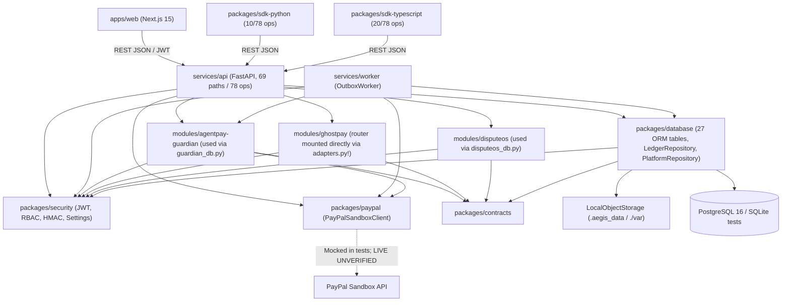

# 01 — Repository & Architecture Forensic Audit

**Audited Branch:** `integration/nexus` (`1be376e`)  
**Workspace Root:** `/home/bigboyaks/Projects/agentpay-nexus`  
**Remote:** `origin -> https://github.com/abhinav29102005/agentpay-nexus.git`  

---

## 1. Git, Branch, Worktree & SCM Forensics

| Check | Observed State (`VERIFIED`) | Risk / Finding |
| :--- | :--- | :--- |
| Current Branch & Status | `integration/nexus` @ `1be376e`; clean working tree | No uncommitted changes |
| `main` Branch | `0108f84` (`origin/main`, `origin/HEAD`) | Behind `integration/nexus`; matches pre-integration contracts/guardian merge |
| `feature/ghostpay` (local vs remote) | Local `ea3c73b`; **`origin/feature/ghostpay` is `2a243e1` (2 commits ahead: `c6c1cab`, `2a243e1`)** | **Branch divergence detected**: remote `feature/ghostpay` received extra commits after `ea3c73b`; unmerged into `integration/nexus` |
| Unmerged Auxiliary Branches | `origin/feature/ghostpay-deployment` (`5bc08f6`), `origin/docs/ghostpay-plan` (`6280b17`) | Potential orphaned work or unreviewed deployment configs |
| Integrated Feature Branches | `feature/disputeos` (`5c648c4`), `feature/guardian` (`894b903`) | Historical feature branches |
| Local Safety Tags | `safety/ghostpay-local` (`e42812c`), `safety/ghostpay-remote` (`94bb16c`), `safety/ghostpay-pre-timemachine` (`f58f756`), `safety/ghostpay-remote-9173a39` (`9173a39`) | Cleanup needed post-stabilization |
| Submodules / Worktrees | None (`git submodule status` empty; single worktree `/mnt/storage/Projects/agentpay-nexus`) | Clean |

---

## 2. Monorepo Structure & Actual Source Inventory (`31,159+` tracked LOC)

- **Shared Packages (`packages/`)**:
  - `packages/contracts/` (`nexus-contracts`): Canonical Pydantic v2 models, enums (`PaymentState`, `DecisionOutcome`, `DecisionReasonCode`, `DisputeStatus`), JSON schema export (`schemas/contracts.schema.json`), SHA-256 `compute_quote_hash`.
  - `packages/security/` (`nexus-security`): Env settings (`NexusSettings`), PBKDF2-SHA256 & HMAC API-key hashing, HS256 JWT, 6-role RBAC matrix (`auth.py`), SHA-256 financial event chain hashing (`hashing.py`), tenant guard (`tenant.py`).
  - `packages/database/` (`nexus-database`): 27 SQLAlchemy 2.0 ORM tables (`orm.py`), `LedgerRepository` (`repository.py`), `PlatformRepository` (`platform_repo.py`), `LocalObjectStorage` (`storage.py`), Alembic migrations (`0001_initial_schema.py`, `0002_aegis_platform_extensions.py`).
  - `packages/paypal/` (`nexus-paypal`): Isolated `PayPalSandboxClient` (`httpx` async Orders v2, signature verification, read-only `list_disputes`).
  - `packages/sdk-python/` (`aegis-sdk`): Synchronous `httpx` client (`client.py`, 241 lines).
  - `packages/sdk-typescript/` (`@aegis-platform/sdk`): Zero-dependency `fetch` + `node:crypto` client (`src/index.ts`, 284 lines).
  - **`packages/ui/`**: **EMPTY DIRECTORY** (abandoned placeholder; actual UI is `apps/web/`).
- **Domain Modules (`modules/`)**:
  - `modules/agentpay-guardian/` (`agentpay-guardian`): Policy engine, passport/approval services, budget & payment coordinators, deterministic copilot stub, standalone router (unused in prod).
  - `modules/ghostpay/` (`agentpay-ghostpay`): Hardened replay/counterfactual/anomalies/provenance/timelines **PLUS** duplicated `timemachine/`, `forensics/`, `ingestion/`, `agentdna/`, and `api/router.py` (directly mounted into unified API).
  - `modules/disputeos/` (`disputeos`): Case service, ingestion normalizer, evidence graph & contradiction rules, deterministic analyzer + fake-tested LLM interface, PayPal adapter stub, standalone router (unused in prod).
- **Applications & Services (`services/`, `apps/`)**:
  - `services/api/` (`aegis-api`): FastAPI factory (`app.py`), auth/orgs, overview, `guardian_db.py`, `disputeos_db.py`, `webhooks.py`, GhostPay adapter (`adapters.py`), rate limiter, structured logging.
  - `services/worker/` (`aegis-worker`): Durable outbox polling + HMAC webhook delivery + PayPal pending payment reconciliation.
  - `apps/web/`: Next.js 15 + React 19 + Tailwind CSS App Router console (`14` routes).
- **Empty / Stale Directories & Docs**:
  - Empty dirs: `packages/ui/`, `scripts/`, `tests/adversarial/`, `tests/concurrency/`, `tests/e2e/`, `tests/integration/`.
  - Stale docs: `README.md` (still labels Guardian, GhostPay, API, Web as "Scaffolded for team handoff"), `docs/TEAM_HANDOFF.md` (outdated pre-implementation checklist), `docs/AEGIS_PLATFORM_BUILD_REPORT.md` (lists 7 non-existent role names like `FINANCE_ADMIN`), `docs/sdk/INTEGRATION_GUIDE.md` (documents wrong `AEGIS-Signature: t=...,v1=...` header & `orgId` param).

---

## 3. Accurate Component Dependency Graph

---

## 4. Architectural Verdict: Integrated Platform vs. Coexisting Modules?

**Verdict: PARTIALLY INTEGRATED (`~65%`) — Strong Shared Spine, Fractured Module Plumbing.**

AEGIS is **not** merely unrelated folders sharing a Git repo:
- **Genuinely unified core**: `contracts`, `security`, `database` (with a single 27-table PostgreSQL schema and canonical `financial_events` hash chain), `services/api`, `services/worker`, and `apps/web` genuinely share one identity model (`tenants`/`users`/`agents`), one `PaymentIntent` -> `FinancialEvent` ledger, and one transactional `OutboxEventRow`.
- **Where integration fractures**:
  1. **Three inconsistent integration patterns across the 3 domain modules**:
     - *Guardian* and *DisputeOS* write clean platform DB routers (`guardian_db.py`, `disputeos_db.py`), leaving their standalone `router.py` files as insecure/in-memory dead code.
     - *GhostPay* mounts its internal `modules/ghostpay/ghostpay/api/router.py` directly into `services/api/aegis_api/app.py:152-155`, bypassing `require_permission(...)` RBAC and splitting endpoints half into PostgreSQL (`*-by-payment/*`, `GET /investigations`) and half into volatile process RAM (`POST /investigations`, `/traces/*`, `/agents/*`).
  2. **Contract drift at boundaries**: Backend Python refactored `PaymentState` (`CAPTURE_PENDING`), `Permission` (`passports:write`), `Role` (6 roles), `DisputeAnalysis` (`grounded_summary`, `citations`), and `X-AEGIS-Signature` (`sha256=...`) without updating `apps/web`, both SDKs, or `docs/`.
  3. **GhostPay internal duplication**: Two separate engines (`replay/engine.py` vs `timemachine/replay.py`), two provenance modules (`provenance/verifier.py` vs `forensics/provenance.py`), two timeline builders, and two anomaly detectors coexist in the same package, AND Guardian vs GhostPay disagree on `"policy-v1"` semantics.

---

## 5. Dependencies, License & Secret Exposure Risks

- **License**: `LICENSE` (`1-21`) is permissive **MIT** (`Copyright (c) 2026 AgentPay Nexus Contributors`). Third-party inspirations documented cleanly in `research/repositories/REUSE_MATRIX.md` (zero GPL contamination observed).
- **Secret Exposure**: `git ls-files` confirms `.env` is excluded (`.gitignore:34-37`) and only `.env.example` is tracked. Real PayPal/OpenAI/Google credentials are blank in source control (`VERIFIED IN CODE`).
- **Config Secret Risk (`HIGH`)**: `.env.example` and `docker-compose.yml` pass `JWT_SECRET`, `RATE_LIMIT_RPM`, and `EVIDENCE_STORAGE_DIR`, whereas `packages/security/security/settings.py:32-52` reads `NEXUS_JWT_SECRET`, `AEGIS_RATE_LIMIT_RPM`, and `AEGIS_EVIDENCE_STORAGE_DIR` — causing silent fallback to `NEXUS_SIGNING_SECRET` (or dev secrets if `APP_ENV` defaults to `development`). Also CI (`ci.yml:69-78`) only checks committed `.env*` filenames, not secret patterns (`gitleaks`), and dependencies/Actions lack vulnerability scans or SHA pinning.

