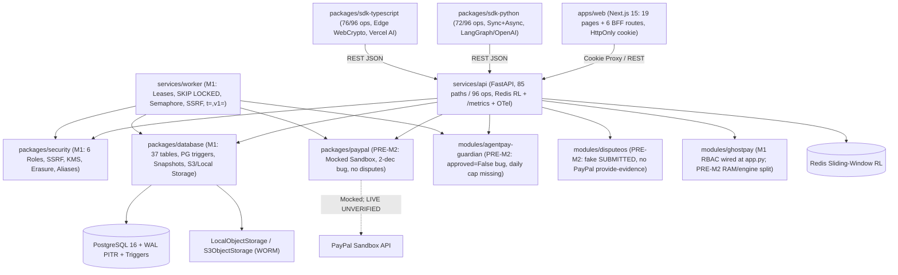

# 01 — Repository & Architecture Forensic Audit

**Audited Branch:** `integration/nexus` (`498043e`, post-M1 + M3 merge over baseline `7829095` / `1be376e`)  
**Workspace Root:** `/home/bigboyaks/Projects/agentpay-nexus`  
**Remote:** `origin -> https://github.com/abhinav29102005/agentpay-nexus.git`

---

## 1. Git, Branch, Worktree & SCM Forensics (`2026-11-12` Sync State)

| Ref / Branch | Observed State (`VERIFIED`) | Sync Status & Risk |
| :--- | :--- | :--- |
| `integration/nexus` | Local `498043e` (`origin/integration/nexus` @ `7829095` prior to push) | Merged `work/m1-platform-security-infra` (`d9ab7b8`) + `work/m3-web-sdks-qa` (`4b5d52f`) with **0 merge conflicts** (`141` files, `+31,275 / -2,132`) |
| `work/m1-platform-security-infra` | Local + remote `d9ab7b8` | **COMPLETE & SYNCED** (`59` files changed, all inside M1 scope; PG16 & Compose smoke verified) |
| `work/m2-financial-forensics-ai` | **ABSENT on `origin` and locally** | **MISSING / UNPUSHED (`BLOCKER`)** — Computer 2's Guardian/PayPal/GhostPay/DisputeOS/AI changes have not been pushed yet |
| `work/m3-web-sdks-qa` | Local + remote `4b5d52f` | **PUSHED & MERGED** (`82` files changed inside M3 scope; minor cleanup needed: `79` Ruff issues + SDK parity vs M1's new endpoints) |
| `main` | `0108f84` (`origin/main`, `origin/HEAD`) | Untouched legacy pre-integration snapshot |
| `feature/ghostpay` | Local `ea3c73b` vs `origin/feature/ghostpay` `2a243e1` | Still 2 commits ahead on remote (`GAP-026` queued for M2 reconciliation) |
| `packages/ui/` | Removed from git (`M3`), empty local dir remains on disk | Cleanup `rmdir packages/ui` safely when desired |

---

## 2. Monorepo Structure & Actual Source Inventory (`integration/nexus` @ `498043e`)

- **Shared Packages (`packages/`):**
  - `packages/contracts/` (`nexus-contracts`): *Unchanged from `1be376e` (waiting on M2)* — Pydantic v2 models, enums, `compute_quote_hash`.
  - `packages/security/` (`nexus-security`): *Updated by M1* — `settings.py` (env aliases + security posture validator), `auth.py` (strict 6 `Role`s, `OWNER` guard, TOTP MFA, OIDC claim validation), `tenant.py` (sanitized 403), `hashing.py` (`AEGIS-Signature: t=,v1=`), `ssrf.py`, `kms.py`, `erasure.py`.
  - `packages/database/` (`nexus-database`): *Updated by M1* — **`37` SQLAlchemy 2.0 ORM tables** (`3` Alembic revisions `0001`–`0003`, PG `financial_events` immutability triggers, `spending_passport_snapshots`, `outbox_events` lease cols, `ghostpay_traces`, `ghostpay_agent_dna_profiles`, `llm_invocation_logs`, `paypal_webhook_events`, billing/erasure/invitations), `storage.py` (`LocalObjectStorage` + `S3ObjectStorage` WORM + streaming 10MB cap).
  - `packages/paypal/` (`nexus-paypal`): *Unchanged from `1be376e` (waiting on M2)* — Mocked Orders v2 client (`JPY`/`BHD` bug + missing disputes/refunds).
  - `packages/sdk-python/` (`aegis-sdk`): *Updated by M3* — `client.py` (`2,043` lines), `AsyncAegisClient`, `exceptions.py`, `pagination.py`, `webhook.py` (`AEGIS-Signature: t=,v1=`), `integrations/{langchain,openai_agents}.py`, `py.typed`, `README.md`, `6` test files (`72/96` OpenAPI ops = `75.0%`).
  - `packages/sdk-typescript/` (`@aegis-platform/sdk`): *Updated by M3* — `client.ts` (`851` lines), `crypto.ts` (Node + Edge WebCrypto), `errors.ts` (fixed FastAPI `detail` parser), `types.ts`, `integrations/vercel-ai.ts`, `README.md`, `4` Vitest suites (`76/96` OpenAPI ops = `79.2%`).
- **Domain Modules (`modules/`) — *ALL WAITING ON M2 (`work/m2-financial-forensics-ai`)*:**
  - `modules/agentpay-guardian/`, `modules/ghostpay/`, `modules/disputeos/`: Still at `1be376e` (`approved=False` bug, `timemachine`/RAM split-brain, DisputeOS fake `SUBMITTED`, deterministic LLM stubs).
- **Applications, Services, Infra & QA (`services/`, `apps/`, `deploy/`, `scripts/`, `tests/`):**
  - `services/api/` (`aegis-api`): **`85` OpenAPI paths (`96` HTTP operations)** via M1 (`auth_orgs.py`, `billing.py`, `erasure.py`, `overview.py`, `webhooks.py`, `rate_limit.py` Redis + SHA-256 keys, `metrics.py` Prometheus + OTel, `deps.py` active principal enforcement, `app.py` GhostPay RBAC + security headers). *(Note: `guardian_db.py`, `disputeos_db.py`, `adapters.py` await M2.)*
  - `services/worker/` (`aegis-worker`): Hardened by M1 — `AEGIS-Signature: t=,v1=`, runtime SSRF IPv4/IPv6 + no-redirect guard, response redaction, lease/reaper, `SKIP LOCKED` reconciliation, `asyncio.Semaphore` dispatch, `--healthcheck`.
  - `apps/web/`: *Updated by M3* — Next.js `15.5.29` / React `19`, **`19` App Router pages + `6` BFF API routes** (`/api/auth/*`, `/api/proxy/[...path]`, `/onboarding`, `/status`, `/legal/{terms,privacy,dpa}`, zero `localStorage` JWTs, CSP/security headers).
  - `deploy/`, `scripts/`: *Added by M1* — `backup_pitr.sh`, `restore_verify.sh`, Grafana dashboard, Prometheus alerts, Linux VPS systemd/Nginx/Compose prod manifests, EU/IN/US residency env examples.
  - `tests/{adversarial,concurrency,e2e,integration}/`: *Populated by M3* — `5` QA suites (`14 passed, 2 failed`; not yet listed in root `pyproject.toml` `testpaths`).

---

## 3. Updated Component Dependency Graph (Post-M1 + M3 Sync)

---

## 4. Architectural Integration Verdict (`498043e`)
**Verdict: INFRASTRUCTURE, SECURITY, UI & SDKS UNIFIED (`~80%`); CORE FINANCIAL ENGINE STILL PRE-M2.**
- **What M1 + M3 Resolved cleanly:** Boundary ownership worked — M1 and M3 merged with **zero git conflicts**. The GhostPay `app.py` RBAC bypass (`GAP-002`), frontend-backend enum/field contract drift (`GAP-004`), Compose env mismatches (`GAP-006`), `ADMIN->OWNER` escalation (`GAP-008`), webhook SSRF (`GAP-003`), signature contract mismatch (`GAP-014`), rate-limit collision (`GAP-007`), `localStorage` JWT (`GAP-018`), PG immutability triggers (`GAP-020`), and observability/backup tooling (`GAP-021`) are all fixed and verified in code.
- **Remaining Architectural Split (Awaiting M2):** `modules/{agentpay-guardian,ghostpay,disputeos}`, `packages/{contracts,paypal}`, `adapters.py`, `guardian_db.py`, and `disputeos_db.py` are unchanged from `1be376e`. M1 already added the PG repository hooks (`save_passport_snapshot`, `save_ghostpay_trace`, `save_agent_dna_profile`, `log_llm_invocation`, `CUSTOMER.DISPUTE.*` webhook dispatch) — they sit ready waiting for `work/m2-financial-forensics-ai` to wire into them.
- **Minor Sync Friction Found:** M1 added `18` new endpoints (`78 -> 96`), dropping M3's SDK OpenAPI parity below the `85%` gate (`75.0%` Py / `79.2%` TS); M3's `concurrency_env` fixture hardcoded SQLite WAL instead of `AEGIS_TEST_POSTGRES_URL`; and M3 left `79` Ruff lint errors (`F401`, `I001`, `2` `F821` in `test_pagination.py`).
