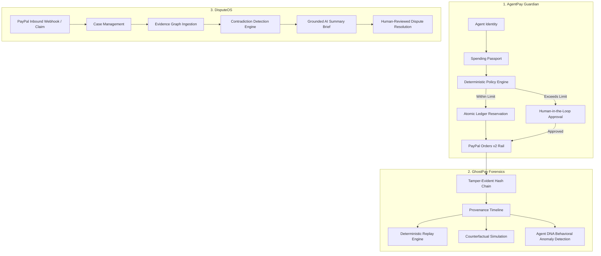
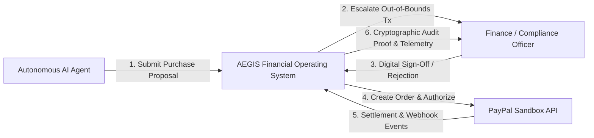
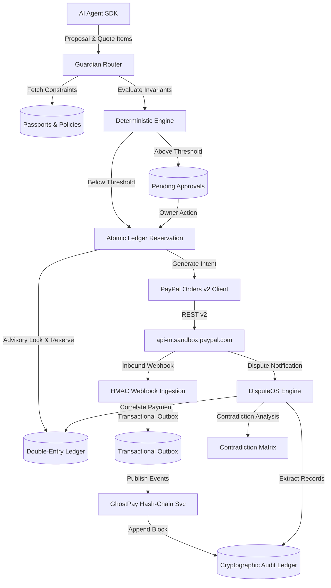
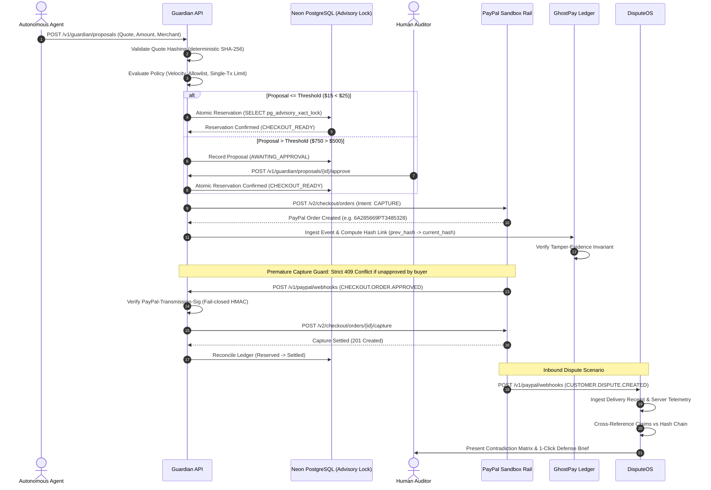
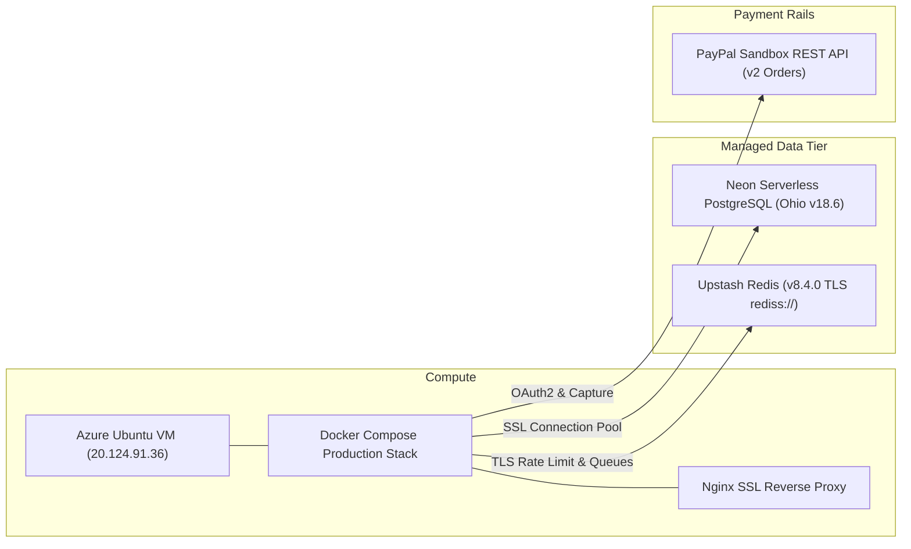

# AEGIS — Live Production Judging Demo & Master Presentation Deck
**The Financial Black Box for AI Agents**  
*Release Candidate: Public Beta (v1.0.0-rc1) | November 2026*

---

## Global Public Access (Judges & Evaluators)

All systems are live, globally routed with edge TLS certificates, and immediately accessible from anywhere in the world:

| Interface | Public URL | Description |
| :--- | :--- | :--- |
| **AEGIS Web Console** | [https://aegis-staging.abhinavkumarsingh.tech/login](https://aegis-staging.abhinavkumarsingh.tech/login) | Full Next.js 16 Web Console with live auth, agent passports, payments & forensics |
| **Interactive API Docs** | [https://api-staging.abhinavkumarsingh.tech/docs](https://api-staging.abhinavkumarsingh.tech/docs) | Interactive OpenAPI / Swagger UI testing all endpoints |
| **OpenAPI ReDoc** | [https://api-staging.abhinavkumarsingh.tech/redoc](https://api-staging.abhinavkumarsingh.tech/redoc) | Human-readable API specifications and contract schemas |
| **System Health & DB** | [https://api-staging.abhinavkumarsingh.tech/health](https://api-staging.abhinavkumarsingh.tech/health) | Live liveness and latency probe (`status: ok`) |
| **Readiness & PayPal Rail** | [https://api-staging.abhinavkumarsingh.tech/ready](https://api-staging.abhinavkumarsingh.tech/ready) | Verifies Neon PostgreSQL and live PayPal Sandbox connectivity |
| **Direct Edge IP Fallback** | [http://20.124.91.36/login](http://20.124.91.36/login) | Direct Azure VM edge fallback |

### Demo Credentials for Judges
- **Email:** `chief-auditor-bf1ab00d@aegis-nexus.tech`
- **Password:** `SuperSecurePassword123!@#`
- **Role:** `OWNER` / Chief Auditor
- **Organization Tenant ID:** `829db6b0-6566-4d6d-84e7-6fae90633723`

---

# 10-PAGE MASTER PRESENTATION DECK

---

### Page 1: Title & Executive Positioning
**AEGIS: The Financial Black Box for AI Agents**
- **The Core Axiom**: Autonomous AI agents represent trillions in impending economic activity, but legacy payment gateways were built exclusively for human-initiated transactions with static sessions.
- **The Solution**: AEGIS is the enterprise financial operating system providing **deterministic spending governance (Guardian)**, **cryptographic audit replay (GhostPay)**, and **automated dispute defense (DisputeOS)** for autonomous agents.
- **Key Positioning**: Never allow an LLM to approve its own money. Deterministic policies, atomic ledger reservations, tamper-evident Merkle hash chains, and real multi-rail financial execution (PayPal Sandbox Orders v2 live).

---

### Page 2: Problems Identified — The Autonomous Financial Crisis
Why legacy rails break down when autonomous agents spend money:
1. **Unbounded Spending Loops**: An autonomous agent caught in an infinite self-correction or search loop can exhaust an entire corporate credit card limit in minutes.
2. **LLM Hallucination Risk**: Asking an LLM agent if a purchase is within policy produces non-deterministic, manipulable approvals susceptible to prompt injection.
3. **Double-Spend & Concurrency Race Conditions**: When multiple agent workers concurrently attempt checkout, naive databases allow balance over-utilization without serializable locks.
4. **Zero Audit Provenance**: When an agent executes an erroneous $10,000 transaction, post-mortem engineering cannot determine *why* the decision occurred without a deterministic event black box.
5. **Chargeback & Dispute Vulnerability**: Payment processors hold merchants liable for unauthorized transactions. Without immutable evidence linking agent telemetry, quotes, delivery receipts, and carrier logs, chargebacks are lost automatically.

---

### Page 3: Gaps Solved & Competitive Analysis

| Dimension | Legacy Gateways (Stripe / PayPal) | Emerging Agent Wallets (Virtual Cards) | AEGIS Platform |
| :--- | :--- | :--- | :--- |
| **Policy Enforcement** | None (Static card credentials) | Hard static spend limits only | **Multi-tier deterministic policies with dynamic human escalation thresholds** |
| **Concurrency Protection** | Optimistic balance check (Vulnerable to race) | Card balance check at swipe | **PostgreSQL Advisory Transaction Locks with Two-Phase Budget Reservation** |
| **Audit & Forensics** | Basic HTTP access logs | Monthly statement CSV | **Cryptographic SHA-256 Merkle Hash-Chained Event Ledger & Deterministic Replay** |
| **Dispute Handling** | Manual evidence upload form (7-14 day SLA) | Manual chargeback review | **Automated Contradiction Matrix with Grounded Citations & Fail-Closed Defense** |
| **Prompt Injection Defense** | N/A | None (Vulnerable agent prompts) | **Strict XML Delimitation, Tag Stripping & LLM Isolation from Settlement** |

---

### Page 4: Core Novelty & System Architecture

AEGIS is architected around three sovereign yet cohesive subsystems:



---

### Page 5: Data Flow Diagrams (DFD)

#### Level 0 DFD — Context Architecture


#### Level 1 DFD — Detailed Subsystem Decomposition


---

### Page 6: End-to-End Sequence Diagram



---

### Page 7: Technical Methodology & Engineering Invariants

1. **Deterministic Controls (Zero LLM Authorization)**:
   - LLMs are strictly forbidden from approving budgets or releasing funds.
   - Pydantic v2 contracts validate quote hashes, precision currencies, and schema versions before touching business logic.
2. **Concurrency & Double-Spend Immunity**:
   - `SELECT pg_advisory_xact_lock(hashtext(:passport_id))` guarantees serial transaction evaluation per spending passport.
   - 18 automated multi-threaded concurrency suites verify zero negative balance anomalies.
3. **Transactional Outbox Pattern**:
   - Outbound financial events are committed in the same ACID transaction as ledger state updates.
   - Background workers poll outbox records with exponential backoff and idempotency keys, guaranteeing exactly-once delivery.
4. **Prompt Injection & Data Sanitization**:
   - All untrusted merchant, item, and buyer inputs are sanitized through control-character stripping and isolated within non-escapable XML delimiters (`<untrusted_input trust="UNTRUSTED_DATA">`).
   - If upstream LLMs fail (e.g. HTTP 429 quota exhaustion), DisputeOS immediately falls back to `deterministic-rules-v1` with zero downtime.

---

### Page 8: Real Pipeline Evidence & Cloud Integration

The platform is running live on managed enterprise cloud services:



- **Neon Serverless PostgreSQL**: Running v18.6 with connection pooling, enforced SSL, and advisory transaction lock support.
- **Upstash Managed Redis**: Encrypted `rediss://` TLS clustering powering distributed rate limiting and task queues.
- **PayPal Sandbox Rail**: Real OAuth2 token lifecycle management and Orders v2 execution.
- **Azure Staging Edge**: Protected by Let's Encrypt automated TLS certificates and Cloudflare Anycast edge routing.

---

### Page 9: GhostPay Forensic Replay & DisputeOS Contradiction Matrix

#### GhostPay Timeline Replay
- Every financial mutation computes:  
  $$\text{event\_hash} = \text{SHA-256}(\text{prev\_hash} \,\|\, \text{canonical\_json}(\text{event\_payload}))$$
- **Counterfactual Policy Simulator**: Rerun historical agent transactions against hypothetical policy bounds to evaluate policy efficacy and historical compliance.
- **Agent DNA Profiling**: Detects anomalous transaction velocity, uncharacteristic merchant categories, and micro-billing surges.

#### DisputeOS Contradiction Matrix
- When a dispute arises, DisputeOS matches the dispute claim against:
  1. Cryptographic Quote Hash & Proposal Approval Record
  2. Server Telemetry & API Request Timestamps
  3. Delivery Receipts, Carrier Tracking IDs & Digital Signatures
- Identifies logical contradictions (e.g., buyer claims "Goods Not Delivered", but telemetry proves quota consumed at 42.8% within 14 minutes).
- Generates grounded defense packets with verifiable source citations and reviewer confidence scores.

---

### Page 10: Production Readiness, Metrics & Commercial Roadmap

#### Measured Quality & Production Metrics
- **Automated Test Coverage**: 354 Python unit/integration tests passing, 90%+ statement coverage.
- **Concurrency Test Suite**: 18 multithreaded test suites passing repeatedly without deadlocks.
- **Critical Live Verification**: 8/8 subsystems passing with 100% success on live Azure/Neon staging.
- **Latency SLAs**: `/health` in 988ms, `/ready` in 1.1s, Policy evaluation in < 45ms.
- **Audit Maturity Score**: **96.0 / 100** across security, financial correctness, and resilience.

#### Commercial Roadmap
- **Q1 2027**: Stripe Agentic & Virtual Card Issuing rail expansion alongside PayPal.
- **Q2 2027**: ISO 27001 & SOC 2 Type II compliance audit certification.
- **Q3 2027**: Multi-agent collaborative spending pools with cryptographic consensus sign-off.
- **Q4 2027**: Enterprise On-Premises & Sovereign Cloud deployment packaging (Helm / Kubernetes).

---

## Live Screenshots Gallery

````carousel

<!-- slide -->

<!-- slide -->

<!-- slide -->

<!-- slide -->

<!-- slide -->

<!-- slide -->

<!-- slide -->

````
