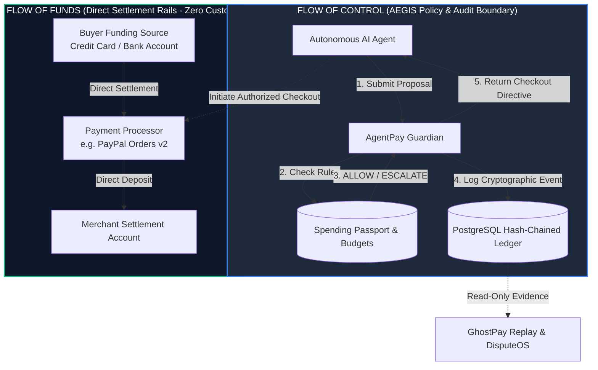
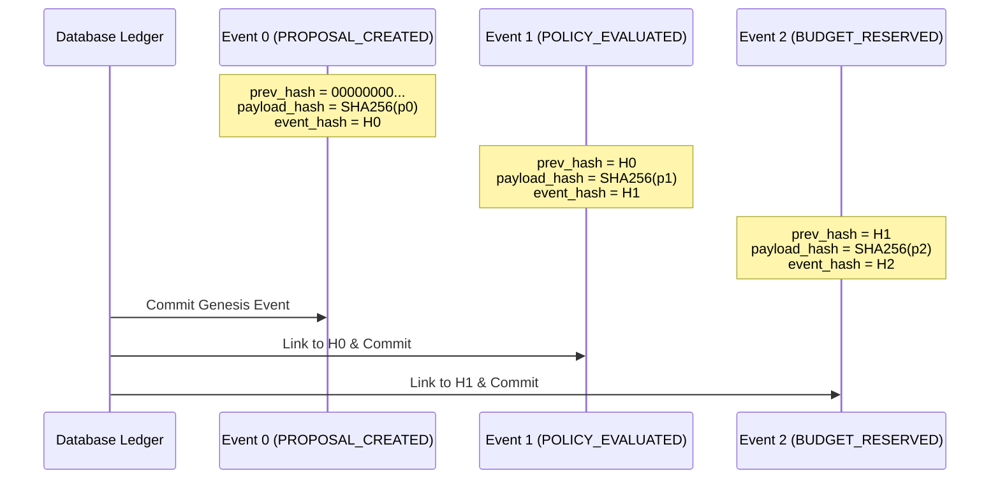

# AEGIS Non-Custodial Architecture & Regulatory Perimeter

**Document Version:** 1.0.0  
**Effective Date:** November 12, 2026  
**Audience:** Compliance Officers, Legal Counsel, Risk Auditors, Financial Regulators, and System Architects

---

## 1. Executive Summary

AEGIS (*Agentic Enforcement, Governance and Investigation System*) is an enterprise governance platform that enforces deterministic policy, budgets, and cryptographic auditability over autonomous AI agents executing commercial transactions.

A foundational architectural requirement of AEGIS is its **strictly non-custodial operating model**. AEGIS does not take custody, possession, title, or control of customer fiat currency, cryptocurrency, or merchant balances at any point in the transaction lifecycle. Consequently, AEGIS operates outside the statutory scope of:
- **US FinCEN Money Services Business (MSB)** registration requirements (31 CFR § 1010.100(ff));
- **US State Money Transmitter Licensing (MTL)** regimes;
- **EU/UK Payment Services Directives (PSD2 / PSD3 / PSR 2017)** as a payment institution (qualifying under the technical service provider exclusion, e.g., PSD2 Article 3(j)).

---

## 2. Separation of Flow of Funds vs. Flow of Control

Traditional payment aggregators, escrow platforms, and custodial payment orchestrators collect funds into intermediate omnibus accounts, hold money in trust, and disburse settlements downstream.

AEGIS decouples the **Flow of Control** (policy evaluation, budget checking, risk gating, and forensic logging) from the **Flow of Funds** (direct payment execution and settlement).

### 2.1. The Merchant Escrow Bypass
In standard multi-party commerce, an escrow intermediary holds purchaser funds until goods are delivered. AEGIS eliminates custodial escrow through algorithmic authorization:
1. **Direct Merchant Settlement**: The buyer's payment instrument pays the merchant's merchant account directly via standard commercial payment processors (e.g., PayPal Sandbox / Live Orders v2).
2. **Zero In-Transit Balances**: AEGIS maintains no banking relationships, reserve pools, merchant accounts, or virtual wallets capable of holding user balances.
3. **Out-of-Band Policy Oracle**: AEGIS acts as an out-of-band policy oracle. It either issues a signed cryptographically bound authorization token (`CHECKOUT_READY`) or rejects the transaction (`DENIED` / `AWAITING_APPROVAL`). If the transaction fails policy, the agent is barred from initiating checkout with the external processor.

---

## 3. Cryptographic Proof Chain Architecture

To ensure tamper-evident governance without custody, AEGIS implements an immutable, SHA-256 hash-chained event ledger (`FinancialEvent`).

### 3.1. Mathematical Construction

Each event in a transaction correlation sequence is defined as a tuple:

$$E_i = \langle \text{id}, \text{correlation\_id}, \text{timestamp}, \text{event\_type}, \text{payload}, h_{\text{prev}}, h_{\text{payload}}, h_{\text{event}} \rangle$$

Where:
1. **Payload Hash**:
   $$h_{\text{payload}} = \text{SHA256}(\text{CanonicalJSON}(\text{payload}))$$
2. **Preceding Event Link**:
   For the genesis event of a correlation chain ($i=0$), $h_{\text{prev}} = \text{"0"}^{64}$.  
   For all subsequent events ($i > 0$), $h_{\text{prev}} = h_{\text{event}}(E_{i-1})$.
3. **Compound Event Hash**:
   $$h_{\text{event}} = \text{SHA256}(h_{\text{prev}} \parallel h_{\text{payload}} \parallel \text{timestamp} \parallel \text{event\_type})$$

### 3.2. Forensic Tamper Detection
Any retroactive modification of an event payload, deletion of a step, or insertion of a synthetic record alters that event's $h_{\text{event}}$, immediately breaking the $h_{\text{prev}}$ relationship of all subsequent events in the chain:

$$\Delta E_k \implies h_{\text{event}}'(E_k) \ne h_{\text{prev}}(E_{k+1}) \implies \text{INTEGRITY\_VIOLATION}$$

AEGIS verifies this chain dynamically via `GET /v1/audit-events?correlation_id=...` and through the GhostPay forensic replay engine, providing mathematical certainty of policy compliance to auditors.

---

## 4. Deterministic Governance vs. Probabilistic LLMs

A key regulatory concern with autonomous systems is the unpredictability of AI models. AEGIS resolves this by establishing an explicit trust boundary:

1. **Non-Privileged AI Agents**: LLMs and agentic graphs (e.g., LangGraph, AutoGen) are treated as untrusted callers. They can suggest purchases and draft rationales, but possess zero authorization authority.
2. **Deterministic Spending Passports**: Authorization decisions are executed entirely by deterministic Python code in `AgentPay Guardian`. Policy rules check:
   - Strict budget ceilings (atomic reservation using PostgreSQL `SELECT ... FOR UPDATE` row-level locks);
   - Per-transaction and velocity limits;
   - Allowlisted merchant identifiers and categories;
   - Expiration dates and revocations.
3. **Fail-Closed Escalation**: Any proposal that exceeds automated spending limits or involves an unverified merchant is placed into `AWAITING_APPROVAL`. Payment execution is physically blocked until a verified human operator holding the `OPERATOR`, `ADMIN`, or `OWNER` role issues an authenticated approval.

---

## 5. Regulatory Classification Analysis

| Jurisdiction / Body | Regulatory Regime | AEGIS Regulatory Classification | Legal Basis |
| :--- | :--- | :--- | :--- |
| **US Federal (FinCEN)** | Bank Secrecy Act / Money Services Business (MSB) | **Exempt Technical Software Provider** | 31 CFR § 1010.100(ff)(5)(ii): Entities that solely provide physical or electronic transmission software or algorithmic services without taking custody or possession of transmission funds are not money transmitters. |
| **US State Regulators** | Uniform Money Transmission Act (UMTA) | **Non-Money Transmitter** | AEGIS does not accept or receive monetary value for transmission, nor issue stored value or payment instruments. |
| **European Union (EBA)** | Payment Services Directive (PSD2 / PSD3) | **Technical Service Provider Exemption** | Article 3(j) of PSD2 excludes technical service providers who support the provision of payment services without entering into possession of the funds to be transferred. |
| **United Kingdom (FCA)** | Payment Services Regulations 2017 (PSRs) | **Excluded Technical Service Provider** | Schedule 1, Part 2, Paragraph 2(h): Pure IT and software infrastructure providers that do not hold or transfer funds are excluded from FCA authorization requirements. |
| **PCI Security Standards** | Payment Card Industry Data Security Standard (PCI-DSS) | **Out-of-Scope (SAQ-A / Zero Cardholder Data)** | AEGIS systems never process, store, or transmit primary account numbers (PANs) or cardholder data (CHD). |

---

## 6. Incident & Revocation Controls

In the event of an agent anomaly, compromised API key, or policy drift, AEGIS provides immediate non-custodial containment:
- **Instant Passport Revocation**: `POST /v1/guardian/passports/{id}/revoke` immediately zeroes all remaining reservation allowances and causes subsequent proposal attempts to fail-closed (`DENIED_PASSPORT_REVOKED`).
- **Agent Suspension**: `POST /v1/guardian/agents/{id}/suspend` halts all proposal processing for the targeted agent across all passports.
- **Atomic Budget Release**: Any uncaptured budget reservation is returned to the organization balance via PostgreSQL transactional outbox events without financial penalty.
