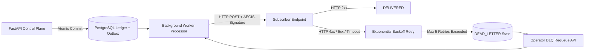

# Runbook: Webhook Outbox & Dead-Letter Queue (DLQ) Management

**Version:** 1.0.0  
**Effective Date:** November 12, 2026  
**Subsystem:** Durable Background Worker (`services/worker`), Transactional Outbox, and Outbound Webhook Dispatcher

---

## 1. Overview & Architecture

AEGIS uses a **Transactional Outbox Pattern** to guarantee reliable delivery of financial events to external systems (e.g., merchant ERPs, enterprise accounting, and automated agent orchestrators).

When a financial state transition commits to PostgreSQL (e.g., `PROPOSAL_CREATED`, `BUDGET_CAPTURED`, `DISPUTE_OPENED`), an event record is atomically inserted into the `outbox_events` table in the same database transaction.

The background worker (`services/worker/aegis_worker/processor.py`) continuously polls pending outbox events, signs payloads with HMAC-SHA256 (`AEGIS-Signature`), and dispatches HTTP POST requests to configured webhook endpoints.



---

## 2. Outbox States & Lifecycle

| State | Description | Next Permitted State |
| :--- | :--- | :--- |
| `PENDING` | Newly enqueued event ready for worker pickup. | `IN_FLIGHT` |
| `IN_FLIGHT` | Worker instance has claimed the row using row-level locking. | `DELIVERED`, `FAILED` |
| `DELIVERED` | Subscriber acknowledged delivery with HTTP `200`-`299`. Terminal. | None |
| `FAILED` | Delivery attempt failed; scheduled for exponential retry. | `IN_FLIGHT`, `DEAD_LETTER` |
| `DEAD_LETTER` | Maximum retry attempts exhausted (default: 5 attempts). Event stalled. | `PENDING` (via manual requeue) |

### Exponential Backoff Schedule
$$\text{delay}(n) = \min(30 \times 2^{n-1}, 3600)\text{ seconds}$$
- **Attempt 1:** Immediate
- **Attempt 2:** +30 seconds
- **Attempt 3:** +2 minutes (120s)
- **Attempt 4:** +8 minutes (480s)
- **Attempt 5:** +32 minutes (1920s)
- **Exhaustion:** Transition to `DEAD_LETTER` status.

---

## 3. Monitoring & DLQ Detection

### 3.1. Identifying Dead-Letter Events via SQL
```sql
SELECT 
    id,
    organization_id,
    event_type,
    retry_count,
    last_error,
    created_at,
    updated_at
FROM outbox_events
WHERE status = 'DEAD_LETTER'
ORDER BY updated_at DESC
LIMIT 50;
```

### 3.2. Querying Dead-Letter Backlog via REST API
```bash
curl -X GET "https://api.aegis.internal/v1/worker/outbox/dead-letter?limit=25" \
  -H "Authorization: Bearer ${OPERATOR_JWT}"
```

### 3.3. Prometheus / CloudWatch Alert Rules
- **Alert:** `AegisOutboxDeadLetterSpike`
  - **Condition:** `sum(aegis_outbox_events_total{status="DEAD_LETTER"}) > 0` for 15 minutes.
  - **Severity:** SEV-2 if > 100 events, SEV-3 otherwise.
- **Alert:** `AegisOutboxProcessingLag`
  - **Condition:** `max(aegis_outbox_oldest_pending_age_seconds) > 300` for 5 minutes.
  - **Severity:** SEV-2.

---

## 4. Triage & Root Cause Analysis

When a webhook enters `DEAD_LETTER`, analyze the `last_error` field and HTTP status code:

1. **HTTP 401 / 403 (Authentication / Signature Mismatch)**:
   - Subscriber rotated their webhook secret without updating the AEGIS Console.
   - Subscriber clock drift exceeds 300s tolerance window on `AEGIS-Signature: t=...,v1=...`.
2. **HTTP 404 (Not Found)**:
   - Subscriber changed endpoint path or deleted the listening route.
3. **HTTP 502 / 503 / 504 or Connection Timed Out**:
   - Subscriber service was down, crashing, or under high load.
4. **SSL / TLS Handshake Failure**:
   - Subscriber expired or misconfigured their HTTPS certificate.

---

## 5. Remediation Playbooks

### Playbook 1: Requeuing a Single Event via API
Once the subscriber resolves their endpoint outage:
```bash
curl -X POST "https://api.aegis.internal/v1/worker/outbox/${OUTBOX_ID}/requeue" \
  -H "Authorization: Bearer ${OPERATOR_JWT}"
```
*Expected Response:*
```json
{
  "outbox_id": "4b68ef50-8b1b-4f93-8f0a-706a19f29104",
  "status": "PENDING",
  "retry_count": 0,
  "message": "Outbox event successfully requeued for immediate delivery"
}
```

### Playbook 2: Bulk Requeuing All Dead-Letter Events for an Organization
If a subscriber experienced an extended outage affecting multiple events:
```sql
UPDATE outbox_events
SET 
    status = 'PENDING',
    retry_count = 0,
    last_error = NULL,
    next_attempt_at = NOW(),
    updated_at = NOW()
WHERE status = 'DEAD_LETTER'
  AND organization_id = '018f3b20-499c-7000-8000-000000000001'
  AND created_at >= NOW() - INTERVAL '48 hours';
```

### Playbook 3: Updating a Broken Webhook Endpoint URL
If the subscriber migrated to a new endpoint URL:
1. Update endpoint in AEGIS Console or via API:
   ```bash
   curl -X PATCH "https://api.aegis.internal/v1/webhooks/endpoints/${ENDPOINT_ID}" \
     -H "Authorization: Bearer ${ADMIN_JWT}" \
     -H "Content-Type: application/json" \
     -d '{"url": "https://api.acme.example/v2/aegis-events"}'
   ```
2. Requeue stalled dead-letter events.

---

## 6. Verification of Delivery

After requeuing, confirm that events transition from `PENDING` to `DELIVERED`:
```sql
SELECT status, count(*) 
FROM outbox_events 
WHERE updated_at >= NOW() - INTERVAL '10 minutes'
GROUP BY status;
```

Inspect delivery log details:
```sql
SELECT endpoint_url, response_status, duration_ms, created_at 
FROM webhook_deliveries
ORDER BY created_at DESC 
LIMIT 10;
```
Ensure HTTP response codes are in the `200`-`299` range.
