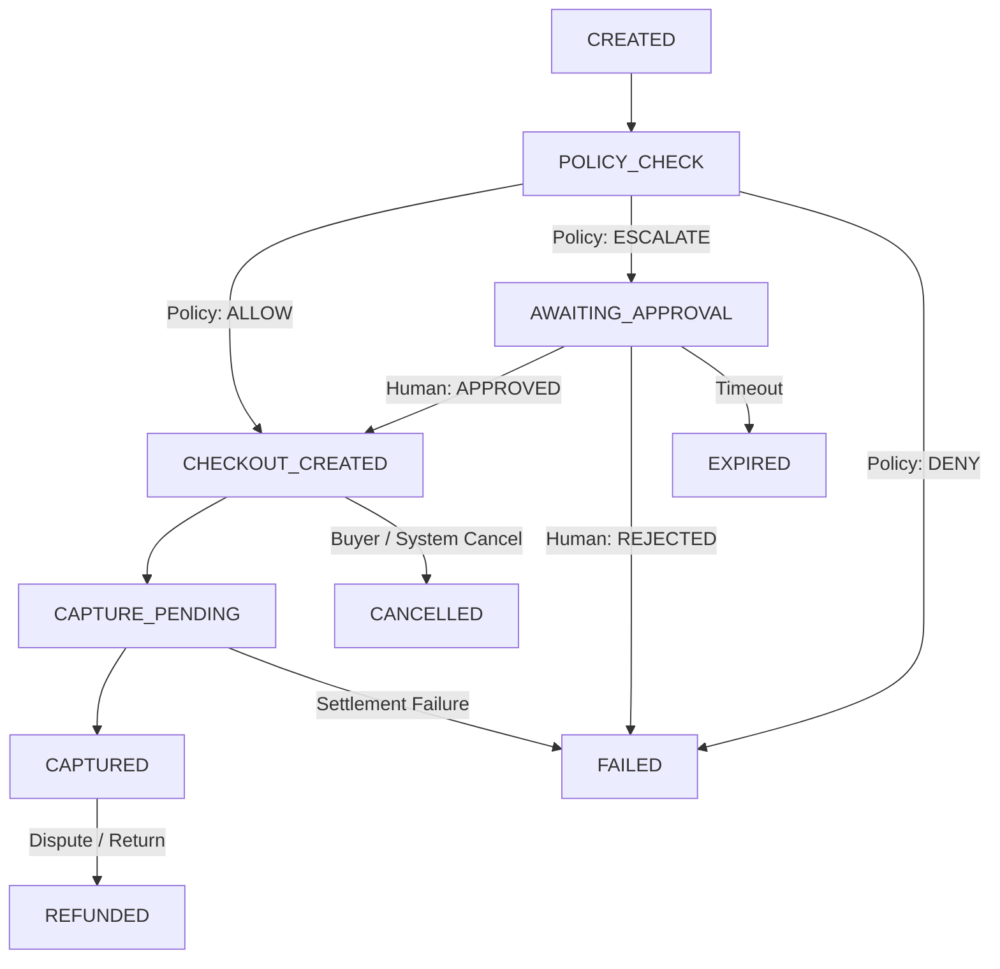

# AEGIS Developer & SDK Integration Guide

AEGIS provides typed client libraries for Python (`aegis-sdk`) and TypeScript (`@aegis-platform/sdk`), enabling applications and autonomous agent runtimes to interact with the versioned AEGIS REST API (`/v1/*`).

---

## 1. Authentication & Role-Based Access Control (RBAC)

AEGIS enforces strict tenant isolation and role-based permissions across all API endpoints.

### 1.1 Canonical Roles (6 Roles ONLY)

Every user membership and service account in an organization is assigned exactly one of the following 6 roles:

| Role | Intended Principal | Allowed Permissions & Capabilities |
| :--- | :--- | :--- |
| `OWNER` | Organization founder / lead | Full administrative permissions, including organization management (`org:manage`), member management, billing, and API key management. |
| `ADMIN` | Security / operations admin | Full operational permissions across members, API keys, agents, passports, webhooks, and financial policies. Lacks `org:manage`. |
| `OPERATOR` | Finance / Risk operator | Can review and decide escalations (`approvals:decide`), manage passports (`passports:write`), trigger checkout/capture, run GhostPay simulations, and manage dispute cases. |
| `AUDITOR` | Compliance / auditor | Read-only access across all records (`audit:read`, `payments:read`, `disputes:read`, etc.) plus read-only forensic simulation in GhostPay (`ghostpay:simulate`). |
| `AGENT_SERVICE` | Autonomous AI agents / workers | Automated machine identity. Can submit purchase proposals (`proposals:write`), read passport limits (`passports:read`), and execute checkout when policy permits. **Never** granted approval or credential authority. |
| `VIEWER` | Read-only team member | Read-only visibility across agents, passports, transactions, disputes, and audit logs. |

### 1.2 Permission Model

Permissions are fine-grained strings. Note specifically:
- Spending passport policies and merchant allowlist constraints are governed by **`passports:write`** (there is no `merchants:write` permission; merchant registry rules are strictly bound to passport scope).
- Agent service accounts operate under `AGENT_SERVICE` with `proposals:write`, `passports:read`, `payments:read`, `payments:checkout`, and `payments:capture`.

---

## 2. Canonical Payment Lifecycle & State Machine

Transactions in AEGIS move through deterministic states. The primary states and transitions are:



### Complete State Reference

| PaymentState | Description | Next Permitted States |
| :--- | :--- | :--- |
| `CREATED` | Spend proposal submitted by agent, recorded in ledger. | `POLICY_CHECK`, `CANCELLED`, `FAILED` |
| `POLICY_CHECK` | Deterministic policy evaluation running against Spending Passport. | `AWAITING_APPROVAL`, `CHECKOUT_CREATED` (or `CHECKOUT_READY`), `FAILED`, `CANCELLED` |
| `AWAITING_APPROVAL` | Proposal exceeded approval threshold; waiting for human review. | `APPROVED`, `FAILED`, `CANCELLED`, `EXPIRED` |
| `APPROVED` | Human operator approved the spend escalation. | `CHECKOUT_CREATED`, `CANCELLED`, `FAILED` |
| `CHECKOUT_CREATED` | PayPal order / checkout session initialized and quote locked. | `CAPTURE_PENDING`, `CANCELLED`, `FAILED` |
| `CAPTURE_PENDING` | Payment authorization confirmed; capture requested from provider. | `CAPTURED` (or `SUCCEEDED`), `FAILED` |
| `CAPTURED` | Provider capture confirmed; ledger budget finalized. Terminal success. | `REFUNDED` |
| `FAILED` | Transaction failed policy, authorization, or settlement. Terminal failure. | None |
| `CANCELLED` | Cancelled by user, agent, or merchant prior to capture. Terminal. | None |
| `EXPIRED` | Quote, approval, or checkout window expired without completion. Terminal. | None |
| `REFUNDED` | Funds returned to buyer following dispute or refund. Terminal. | None |

---

## 3. Python Integration (`aegis-sdk`)

### 3.1 Installation

```bash
pip install aegis-sdk
# or via uv:
uv add aegis-sdk
```

### 3.2 Executable Quickstart: Proposing Spend & Forensic Replay

```python
import os
from uuid import uuid4
from aegis_sdk import AegisClient, AgentAuthorizationTool

# 1. Initialize client with base URL and API Key or JWT token
base_url = os.getenv("AEGIS_BASE_URL", "http://localhost:8000")
api_key = os.getenv("AEGIS_API_KEY", "aegis_dev_testkey1234567890abcdef")

client = AegisClient(base_url=base_url, api_key=api_key)

# Optional: login with credentials to obtain a session
# session = client.login(email="operator@acme.test", password="SecurePassword123!")
# client.set_token(session["access_token"])

agent_id = "550e8400-e29b-41d4-a716-446655440000"
passport_id = "6ba7b810-9dad-11d1-80b4-00c04fd430c8"
merchant_id = "6ba7b811-9dad-11d1-80b4-00c04fd430c8"

# 2. Submit an idempotent purchase proposal
proposal_res = client.submit_purchase_proposal(
    agent_id=agent_id,
    passport_id=passport_id,
    merchant_id=merchant_id,
    merchant_name="Acme Compute Services",
    merchant_category="SOFTWARE",
    amount_minor=4500,  # $45.00
    currency="USD",
    item_summary="GPU Cloud Inference Credits",
    rationale="Automated batch summarization workload",
    idempotency_key=f"prop-{uuid4().hex[:12]}",
)

payment_intent = proposal_res.get("payment_intent", proposal_res)
intent_id = payment_intent["id"]
status = payment_intent.get("state") or payment_intent.get("status")
print(f"Proposal submitted. Intent ID: {intent_id}, State: {status}")

# 3. If approval is required (ESCALATED / AWAITING_APPROVAL), an operator approves:
if status in ("AWAITING_APPROVAL", "ESCALATED"):
    print("Proposal requires human approval. Approving...")
    approval_res = client.approve_proposal(
        intent_id=intent_id,
        approver_id="usr-operator-001",
        comment="Approved for batch inference",
    )
    print("Approved:", approval_res)

# 4. Initiate checkout session
checkout_res = client.initiate_checkout(
    intent_id=intent_id,
    idempotency_key=f"chk-{uuid4().hex[:12]}",
)
print("Checkout ready:", checkout_res)

# 5. Read payment details from ledger
payment = client.get_payment(intent_id=intent_id)
print(f"Payment state: {payment.get('state')}")

# 6. Execute deterministic, read-only forensic replay in GhostPay
replay_res = client.replay_by_payment(intent_id=intent_id)
assert replay_res.get("executed_payment") is False, "Replay must never execute actual payments"
print("GhostPay Replay Consistency:", replay_res.get("consistency_status", "CONSISTENT"))

# 7. Run counterfactual policy simulation
sim_res = client.simulate_by_payment(
    intent_id=intent_id,
    overrides={"per_tx_limit_minor": 2000},  # hypothetical $20.00 limit
)
print("Simulation outcome under new policy:", sim_res.get("simulated_outcome"))

client.close()
```

### 3.3 Autonomous Agent Middleware (`AgentAuthorizationTool`)

For LangGraph or custom AI agent loops, wrap purchasing logic inside `AgentAuthorizationTool`:

```python
from aegis_sdk import AegisClient, AgentAuthorizationTool

client = AegisClient(
    base_url="http://localhost:8000",
    api_key="aegis_dev_agentkey_0987654321",  # AGENT_SERVICE role
)

agent_tool = AgentAuthorizationTool(
    client,
    agent_id="550e8400-e29b-41d4-a716-446655440000",
    passport_id="6ba7b810-9dad-11d1-80b4-00c04fd430c8",
)

# Agent proposes purchase without touching direct PayPal credentials
decision = agent_tool.request_purchase_authorization(
    merchant_id="6ba7b811-9dad-11d1-80b4-00c04fd430c8",
    merchant_name="API Dataset Provider",
    merchant_category="DATA_SERVICES",
    amount_minor=1200,  # $12.00
    item_summary="Domain knowledge dataset download",
    rationale="Customer onboarding enrichment",
    currency="USD",
)

if decision.get("decision", {}).get("outcome") == "ALLOW":
    print("Spend authorized. Intent enters CHECKOUT_READY.")
else:
    print("Spend denied or escalated to human operator.")
```

---

## 4. TypeScript Integration (`@aegis-platform/sdk`)

### 4.1 Installation

```bash
npm install @aegis-platform/sdk
```

### 4.2 Executable Quickstart

```typescript
import { AegisClient, SubmitProposalInput } from "@aegis-platform/sdk";

async function main() {
  const client = new AegisClient({
    baseUrl: process.env.AEGIS_BASE_URL ?? "http://localhost:8000",
    apiKey: process.env.AEGIS_API_KEY ?? "aegis_dev_testkey1234567890abcdef",
    organizationId: process.env.AEGIS_ORG_ID,
  });

  // 1. Create agent and merchant (requires ADMIN or OWNER)
  const agent = await client.createAgent({
    name: "data-enricher-bot",
    purpose: "Purchases API data feeds",
    framework: "langchain",
    public_fingerprint: "sha256:7a92c3f1b4...",
  });

  const merchant = await client.createMerchant({
    name: "Enrichment Co",
    domain: "enrichment.example.com",
    category: "DATA_SERVICES",
    is_allowlisted: true,
  });

  // 2. Issue Spending Passport (enforcing passports:write)
  const passport = await client.createPassport({
    agent_id: agent.id,
    total_budget_minor: 100000,              // $1,000.00
    per_tx_limit_minor: 25000,               // $250.00
    daily_limit_minor: 50000,                // $500.00
    human_approval_threshold_minor: 10000,   // $100.00
    allowed_merchant_ids: [merchant.id],
    allowed_categories: ["DATA_SERVICES"],
    allow_unknown_merchants: false,
  });

  // 3. Submit purchase proposal
  const proposalInput: SubmitProposalInput = {
    agent_id: agent.id as string,
    passport_id: passport.id as string,
    merchant_id: merchant.id as string,
    merchant_name: "Enrichment Co",
    merchant_category: "DATA_SERVICES",
    amount_minor: 4900,                      // $49.00
    currency: "USD",
    item_summary="Data feed Q4",
    rationale: "Quarterly industry dataset update",
    idempotency_key: `ts-prop-${Date.now()}`,
  };

  const proposal = await client.submitPurchaseProposal(proposalInput);
  const paymentIntent = (proposal.payment_intent ?? proposal) as { id: string; state?: string };
  console.log("Proposal created:", paymentIntent.id);

  // 4. Retrieve payment detail
  const detail = await client.getPaymentDetail(paymentIntent.id);
  console.log("Payment status:", detail);

  // 5. Run GhostPay replay and simulation
  const replay = await client.replayByPayment(paymentIntent.id);
  console.log("Replay result (executed_payment=false):", replay);

  const simulation = await client.simulateByPayment(paymentIntent.id, {
    per_tx_limit_minor: 2000,
  });
  console.log("Simulation result:", simulation);
}

main().catch(console.error);
```

---

## 5. Webhook Signature Verification (`AEGIS-Signature`)

Every outbound webhook dispatched by AEGIS includes the `AEGIS-Signature` header formatted as:

$$\text{AEGIS-Signature: } t=\langle\text{unix\_seconds}\rangle,v1=\langle\text{hex\_hmac\_sha256}\rangle$$

The signature is computed over:
$$\text{signed\_content} = \text{timestamp} + "." + \text{raw\_body}$$

To prevent replay attacks, verifiers must validate that:
1. The timestamp $|t_{\text{current}} - t_{\text{header}}| \le 300\text{ seconds}$ (5-minute tolerance window).
2. The computed HMAC-SHA256 matches $v1$ using constant-time comparison.

### 5.1 Python Verifier Implementation

```python
import hashlib
import hmac
import time
from typing import Tuple

def parse_aegis_signature(header: str) -> Tuple[int, str]:
    """Parse header of the format 't=1731384000,v1=5d41402abc...'"""
    parts = dict(item.strip().split("=", 1) for item in header.split(",") if "=" in item)
    if "t" not in parts or "v1" not in parts:
        raise ValueError("Invalid AEGIS-Signature header format")
    return int(parts["t"]), parts["v1"]

def verify_aegis_webhook(
    *,
    raw_payload_bytes: bytes,
    signature_header: str,
    secret: str,
    tolerance_seconds: int = 300,
) -> bool:
    """Verify outbound AEGIS webhook signature with timestamp freshness check."""
    try:
        timestamp, expected_signature = parse_aegis_signature(signature_header)
    except Exception:
        return False

    current_time = int(time.time())
    if abs(current_time - timestamp) > tolerance_seconds:
        # Replay attack prevention: timestamp is too far in the past or future
        return False

    signed_payload = f"{timestamp}.".encode("utf-8") + raw_payload_bytes
    computed_signature = hmac.new(
        secret.encode("utf-8"),
        signed_payload,
        hashlib.sha256,
    ).hexdigest()

    return hmac.compare_digest(computed_signature, expected_signature)
```

### 5.2 TypeScript / Node.js Verifier Implementation

```typescript
import { createHmac, timingSafeEqual } from "node:crypto";

export function verifyAegisWebhook(params: {
  rawPayload: Buffer | string;
  signatureHeader: string;
  secret: string;
  toleranceSeconds?: number;
}): boolean {
  const { rawPayload, signatureHeader, secret, toleranceSeconds = 300 } = params;

  // 1. Parse header components
  const parts = Object.fromEntries(
    signatureHeader.split(",").map((part) => {
      const [key, ...vals] = part.trim().split("=");
      return [key, vals.join("=")];
    })
  );

  const timestampStr = parts["t"];
  const signature = parts["v1"];

  if (!timestampStr || !signature) {
    return false;
  }

  const timestamp = parseInt(timestampStr, 10);
  if (isNaN(timestamp)) {
    return false;
  }

  // 2. Tolerance window check against replay attacks
  const now = Math.floor(Date.now() / 1000);
  if (Math.abs(now - timestamp) > toleranceSeconds) {
    return false;
  }

  // 3. Constant-time HMAC comparison
  const rawBuf = Buffer.isBuffer(rawPayload) ? rawPayload : Buffer.from(rawPayload, "utf8");
  const prefix = Buffer.from(`${timestamp}.`, "utf8");
  const signedPayload = Buffer.concat([prefix, rawBuf]);

  const expected = createHmac("sha256", secret).update(signedPayload).digest("hex");

  if (expected.length !== signature.length) {
    return false;
  }

  return timingSafeEqual(Buffer.from(expected, "utf8"), Buffer.from(signature, "utf8"));
}
```

---

## 6. Error Handling

AEGIS REST APIs return RFC 7807-compatible structured errors.

```json
{
  "detail": {
    "message": "Transaction exceeds Spending Passport per-transaction limit of 25000 minor units",
    "reason_code": "DENIED_EXCEEDS_PER_TX_LIMIT",
    "correlation_id": "8f3b2049-9c5e-4c74-90a1-43e91b5d6e27"
  }
}
```

In the SDKs:
- **Python**: Catches `AegisAPIError` containing `e.status_code`, `str(e)`, and `e.payload`.
- **TypeScript**: Catches `AegisAPIError` with `err.statusCode`, `err.message`, and `err.payload`.
